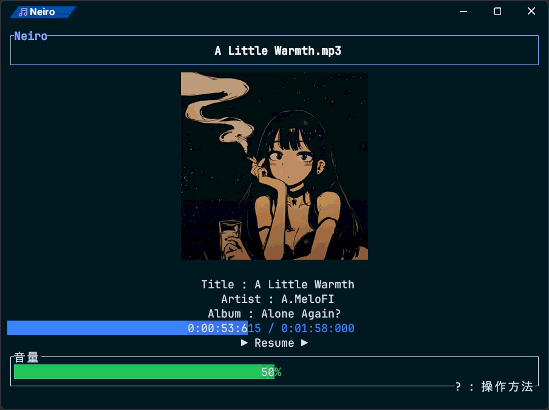

# Neiro（ねゐろ）
[日本語](./README.md) / [English](./README/README-en.md)
```bash
sap
```
ターミナル上で動作するシンプルなオーディオプレイヤー



## ❄ 特徴
- 再生することだけを目標にしたTUI表示
- WindowsとLinuxで動作

## 💻 実行環境
### 検証済
- [x] Windows 11
- [x] Linux
### 未検証
- [ ] Mac

## 📦 インストール

### cargo
#### `cargo install`
```bash
cargo install Neiro
```
#### `cargo binstall`
```bash
cargo binstall Neiro
```
#### `cargo install --git`
```bash
cargo install --locked --git https://github.com/c0b23092db/neiro
```

## 🎼 使用方法
```
❯ sap --help
Neiro / Simple Audio File Player

Usage: sap [OPTIONS] [FILE]
       sap <COMMAND>

Commands:
  pause   Pause the Neiro playing in the background
  resume  Resume the Neiro playing in the background
  stop    Stop the Neiro playing in the background
  help    Print this message or the help of the given subcommand(s)

Arguments:
  [FILE]
          Audio file path

Options:
  -t, --timer <TIMER>
          Timer of Audio file (0 for full playback)
          [default: 0]
  -v, --volume <VOLUME>
          Volume of Audio file [0-200]
          [default: 50]
  -r, --repeat
          Repeat the Audio file
      --tui
          Run in TUI mode with UI controls (default)
  -c, --cli
          Run in CLI mode without UI
  -a, --async
          Play in the background and return immediately
  -h, --help
          Print help (see a summary with '-h')
  -V, --version
          Print version
```

### TUIモード
```batch
sap audio.mp3
```
TUI上で再生するモードです。オプションを指定しない場合はこのモードで起動します。

オーディオファイルにジャケットが含まれている場合は中央に表示します。
埋め込まれていない場合は、同じフォルダの`cover` / `folder` / `front` / `album`（jpg・png・webp）を使用します。

- Timer（オプション）
  曲の再生時間を指定する。
- Volume（オプション）
  曲の音量を指定する。
```batch
> sap audio.mp3 -v 10 -t 10
```

#### TUIの操作
- Esc / q / Ctrl + c: 終了
- ?: 操作方法の表示 / 非表示
- スペースキー: 再開 / 一時停止
- r: リプレイ
- l: リピートの切り替え
- s: オーディオファイルの取り出し
- ↑ ↓: 音量の変更。Shift同時押しで大きく変更。
- ← →: 再生位置の変更。Shift同時押しで大きく変更。

### CLIモード（同期再生モード）
```batch
> sap.exe --cli audio.mp3
.\audio.mp3 | 2:42 | 2:42
```
コマンドラインで実行するモードです。

`--cli`を付けない場合でも、出力先が端末でないとき（パイプやリダイレクトなど）はこのモードで再生します。

再生を停止するときは`Ctrl + C`を使用してください。

オプションと書かれている引数は`-v`や`-h`などを追加して使用します。

- Timer（オプション）
  曲の再生時間を指定する。 **0で曲を最後まで再生する。**
```batch
> sap.exe --cli audio.mp3 -t 10
.\audio.mp3 | 2:42 | 0:10
```

- Volume（オプション）
  曲の音量を指定する。
  指定できる音量：0% ~ 200%
  200を超える数値が入力された場合、強制的に200%に変換する。
```batch
> sap.exe --cli audio.mp3 -t 5 -v 10
.\audio.mp3 | 2:42 | 0:05
```

### 非同期再生モード
```batch
sap -a audio.mp3
sap pause
sap resume
sap stop
```
バックグラウンドで再生し、コマンドはすぐに戻ります。
**`pause` / `resume` / `stop` はLinuxのみ対応しています。**（MPRISを使用します）
`sap pause` / `sap resume` / `sap stop` は再生中のすべてのNeiroを操作します。TUIモード・CLIモードで再生中のものも対象です。

`-t`（Timer）/ `-v`（Volume）/ `-r`（Repeat）を指定できます。

### メディアコントロール（Linux）
Linuxでは再生中、MPRISにプレイヤーとして登録されます。
デスクトップシェル（Noctaliaなど）や`playerctl`から、曲名・ジャケットの取得と再生 / 一時停止・シーク・音量変更・停止ができます。

## 🔍開発者🔎
- c0b23092db

## ♪開発に使用した音源♪
- [Amethyst break1](https://minecraft.fandom.com/wiki/Category:Amethyst_sounds)
- [神々の宿る場所](https://amachamusic.chagasi.com/music_kamigaminoyadorubasho.html)
- [4小節ごとにジャンルが変わるUnwelcome School.Remix](https://booth.pm/ja/items/6307718)

## 📄ライセンス📝
[MIT Licence](./LICENSE.md) / <http://opensource.org/licenses/MIT>

