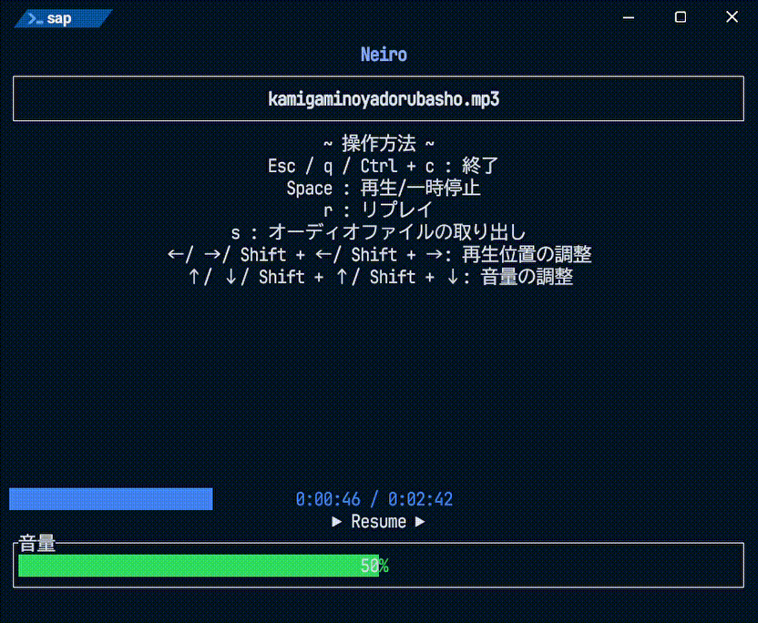

# <span style="color:#A0ffff">Neiro （ねゐろ）</span>
[日本語](README.md)・[English](./README/README-en.md)
```batch
sap.exe
```
(*'▽')＜ターミナル上で動作するシンプルなオーディオプレイヤーです。



## ❄概要❄
- ターミナル上で動作するシンプルなオーディオプレイヤー
- コマンドによる再生、TUIによる操作

## 💻実行環境💻
- [x] Windows 11

## ⬇インストール⬇

### バイナリ
- Windows : [sap.exe](https://github.com/c0b23092db/neiro/releases/download/0.2.1/sap.exe)
- Windows : [sap.zip](https://github.com/c0b23092db/neiro/releases/download/0.2.1/sap-v0.2.1-x86_64-pc-windows-msvc.zip)

### cargo
```batch
cargo install Neiro
```

```batch
cargo binstall Neiro
```

```batch
cargo install --locked --git https://github.com/c0b23092db/neiro
```

## 🎼使用方法🎶
```
Simple Audio File Player in Terminal

Usage: sap.exe [オプション] <ファイル名>

Arguments:
  <ファイル名>   オーディオファイルのパス

オプション:
  -t, --timer <TIMER>    再生時間を指定する (0: 最後まで再生する) [デフォルト: 0]
  -v, --volume <VOLUME>  曲の音量を指定する [0-100] [デフォルト:50]
      --tui          TUIモードで起動する。（標準）
  -c, --cli          CLIモードで起動する。
  -h, --help         ヘルプを表示する。
  -V, --version      バージョンを表示する。
```

### 同期再生モード（CLIモード）
```batch
> sap.exe --cli audio.mp3
.\audio.mp3 | 2:42 | 2:42
```
コマンドラインで実行するモードです。

`--cli`を付けない場合でも、出力先が端末でないとき（パイプやリダイレクトなど）はこのモードで再生します。

再生を停止するときは`Ctrl + C`を使用してください。

オプションと書かれている引数は`-v`や`-h`などを追加して使用します。

- Timer（オプション）

  　曲の再生時間を指定する。
  　**0で曲を最後まで再生する。**
```batch
> sap.exe --cli audio.mp3 -t 10
.\audio.mp3 | 2:42 | 0:10
```

- Volume（オプション）

  　曲の音量を指定する。
  　指定できる音量：0% ~ 200%
  　200を超える数値が入力された場合、強制的に200%に変換する。
```batch
> sap.exe --cli audio.mp3 -t 5 -v 10
.\audio.mp3 | 2:42 | 0:05
```

### インタラクティブモード（TUIモード）
```batch
sap audio.mp3
```
TUI上で再生するモードです。オプションを指定しない場合はこのモードで起動します。

オーディオファイルにジャケットが含まれている場合は中央に表示します。
埋め込まれていない場合は、同じフォルダの`cover` / `folder` / `front` / `album`（jpg・png・webp）を使用します。

- Timer（オプション）
  　曲の再生時間を指定する。

- Volume（オプション）
  　曲の音量を指定する。
```batch
> sap.exe audio.mp3 -v 10
```

#### TUIの操作
- Esc / q / Ctrl + c
  終了
- ?
  操作方法の表示 / 非表示
- スペースキー
  再開 / 一時停止
- r
  リプレイ
- s
  オーディオファイルの取り出し
- ↑ ↓
  音量の変更。Shift同時押しで大きく変更。
- ← →
  再生位置の変更。Shift同時押しで大きく変更。

### メディアコントロール（Linux）
Linuxでは再生中、MPRISにプレイヤーとして登録されます。
デスクトップシェル（Noctaliaなど）や`playerctl`から、曲名・ジャケットの取得と再生 / 一時停止・シーク・音量変更・停止ができます。

### ~~非同期再生モード~~
この機能は**未実装**です。
```batch
sap -a audio.mp3
sap pause
sap resume
sap stop
```

## 実装予定
- [x] 同期再生モード
- [x] インタラクティブモード
- [ ] 非同期再生モード

## 🔍開発者🔎
- いかた゚ ： [](url)

## ♪開発に使用した音源♪
- [Amethyst break1](https://minecraft.fandom.com/wiki/Category:Amethyst_sounds)
- [神々の宿る場所](https://amachamusic.chagasi.com/music_kamigaminoyadorubasho.html)
- [4小節ごとにジャンルが変わるUnwelcome School.Remix](https://booth.pm/ja/items/6307718)

## 📄ライセンス📝
[MIT Licence](./LICENSE.md) / <http://opensource.org/licenses/MIT>
