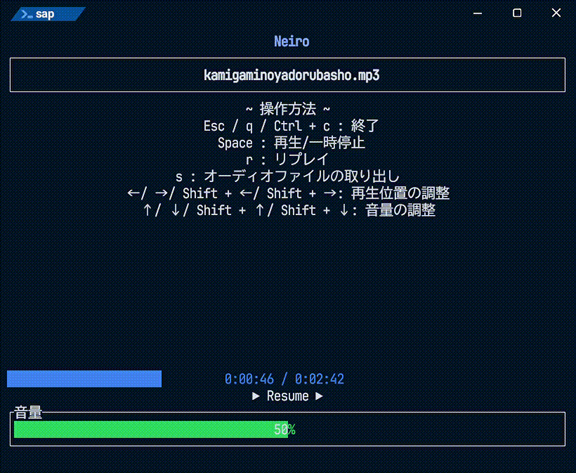

# <span style="color:#A0ffff">Neiro / Simple Audio File Player</span>

This README-en.md was translated from README.md by Claude Sonnet 4.

[日本語](../README.md)・[English](README-en.md)
```batch
sap.exe
```
(*'▽')＜ A simple audio player that runs in the terminal.



## ❄Overview❄
- A simple audio player that runs in the terminal
- Playback via commands and TUI-based controls

## 💻Runtime Environment💻
- [x] Windows 11

## ⬇Installation⬇

### Binary
- Windows : [sap.exe](https://github.com/c0b23092db/neiro/releases/download/0.2.0/sap.exe)
- Windows : [sap.zip](https://github.com/c0b23092db/neiro/releases/download/0.2.0/sap-v0.2.0-x86_64-pc-windows-msvc.zip)

### cargo
```batch
cargo install --locked --git https://github.com/c0b23092db/neiro
```

## 🎼Usage🎶
```
Simple Audio File Player in Terminal

Usage: sap.exe [OPTIONS] <FILE>

Arguments:
  <FILE>  Audio file path

Options:
  -t, --timer <TIMER>    Timer of Audio file (0 for full playback) [default: 0]
  -v, --volume <VOLUME>  Volume of Audio file [0-100] [default: 50]
      --tui              Run in TUI mode with UI controls (default)
  -c, --cli              Run in CLI mode without UI
  -h, --help             Print help (see more with '--help')
  -V, --version          Print version
```

### Synchronous Playback Mode (CLI mode)
```batch
> sap.exe --cli audio.mp3
.\audio.mp3 | 2:42 | 2:42
```
This is the command-line execution mode.
Even without `--cli`, this mode is used when the output is not a terminal (pipes, redirects, etc.).
Use `Ctrl + C` to stop playback.
Optional arguments like `-v` or `-h` can be added as needed.

- Timer (Optional)
  Specify the playback duration of the audio file.
  **Use 0 to play the entire file.**
```batch
> sap.exe --cli audio.mp3 -t 10
.\audio.mp3 | 2:42 | 0:10
```

- Volume (Optional)
  Specify the audio volume.
```batch
> sap.exe --cli audio.mp3 -t 5 -v 10
.\audio.mp3 | 2:42 | 0:05
```

### Interactive Mode (TUI mode)
```batch
sap audio.mp3
```
This mode provides TUI-based playback controls. It is the default mode.

If the audio file contains cover art, it is displayed in the center.
If none is embedded, `cover` / `folder` / `front` / `album` (jpg, png, webp) in the same folder is used.

- Timer (Optional)
  Specify the playback duration of the audio file.

- Volume (Optional)
  Specify the audio volume.
```batch
> sap.exe audio.mp3 -v 10
```

#### Controls:
- Esc / q / Ctrl + c
  Exit
- ?
  Show / hide the controls
- Space
  Resume / Pause
- r
  Replay
- s
  Extract audio file
- ↑ ↓
  Volume adjustment. Hold Shift for larger changes.
- ← →
  Seek position adjustment. Hold Shift for larger changes.

### Media Controls (Linux)
On Linux, the player is registered with MPRIS during playback.
Desktop shells (such as Noctalia) and `playerctl` can read the title and cover art, and control play / pause, seek, volume and stop.

### ~~Asynchronous Playback Mode~~
This feature is **not yet implemented**.
```batch
sap -a audio.mp3
sap pause
sap resume
sap stop
```

## Implementation Roadmap
- [x] Synchronous playback mode
- [x] Interactive mode
- [ ] Asynchronous playback mode

## 🔍Developer🔎
- いかた゚ : [](url)

## ♪Audio Sources Used in Development♪
- [Amethyst break1](https://minecraft.fandom.com/wiki/Category:Amethyst_sounds)
- [神々の宿る場所](https://amachamusic.chagasi.com/music_kamigaminoyadorubasho.html)
- [4小節ごとにジャンルが変わるUnwelcome School.Remix](https://booth.pm/ja/items/6307718)

## 📄License📝
[MIT Licence](../LICENSE.md) / <http://opensource.org/licenses/MIT>
